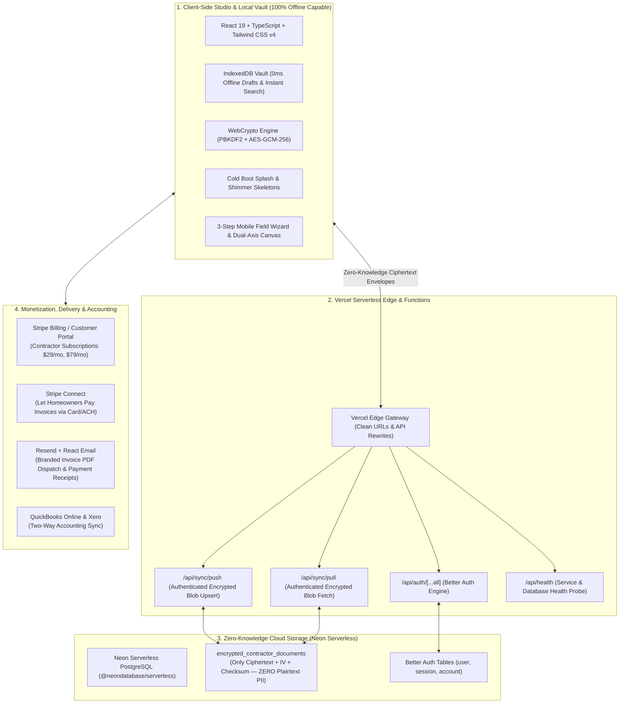

# TrueSquare — Full-Fledged SaaS Tech Stack & Cloud Architecture

> **Offline-First Zero-Knowledge Invoicing & Estimating Studio for Construction Contractors**  
> Architected for Vercel Serverless, Neon PostgreSQL, Better Auth, and Client-Side WebCrypto AES-GCM-256.

---



---

## 1. Zero-Knowledge Serverless Architecture (The Privacy Foundation)

### Why Zero-Knowledge Cloud Sync?
Traditional SaaS applications store customer PII, client addresses, job details, and financial transactions in plaintext database tables. In the construction trade:
1. **Contractor Data Sovereignty**: Contractors consider their customer lists, labor rates, and supply markups proprietary business secrets.
2. **Zero Breach Liability**: Even if the cloud database were dumped or compromised, attackers only acquire AES-GCM-256 ciphertext blobs. The server never possesses the master decryption key.
3. **True Jobsite Offline Resilience**: When working in basements, steel builds, or rural areas without 5G, TrueSquare never blocks or fails. 100% of drafting, calculations, catalog lookups, and PDF generation happen in local IndexedDB. Sync triggers silently in the background when connectivity resumes.

---

## 2. Serverless Cloud Infrastructure (Vercel + Neon)

| Layer | Technology | Role | Free/Bootstrapped Tier |
| :--- | :--- | :--- | :--- |
| **Compute & Functions** | Vercel Serverless Functions | Hosts `/api/auth` and `/api/sync` endpoints | 100GB-hrs / 1M executions |
| **Database** | Neon Serverless PostgreSQL | Auto-scaling serverless database with zero-idle cost | 0.5 GB storage & 100 hours compute |
| **Authentication** | Better Auth | Modern, self-hosted session engine backed by Neon pool | 100% Free / Open Source |
| **Sync Protocol** | WebCrypto AES-GCM-256 | Client encrypts documents before HTTPS POST | 0ms / Browser Native |

### Database Schema in Neon
```sql
CREATE TABLE IF NOT EXISTS encrypted_contractor_documents (
  id VARCHAR(128) PRIMARY KEY,
  user_id VARCHAR(128) NOT NULL,
  document_id VARCHAR(128) NOT NULL,
  document_number VARCHAR(64) NOT NULL,
  document_type VARCHAR(32) NOT NULL,
  version INTEGER NOT NULL DEFAULT 1,
  encrypted_payload_base64 TEXT NOT NULL,
  checksum_sha256 VARCHAR(64) NOT NULL,
  updated_at TIMESTAMPTZ NOT NULL DEFAULT NOW(),
  created_at TIMESTAMPTZ NOT NULL DEFAULT NOW(),
  UNIQUE(user_id, document_id)
);
CREATE INDEX IF NOT EXISTS idx_contractor_docs_user ON encrypted_contractor_documents(user_id);
```

---

## 3. Monetization & Contractor Billing

### A. Stripe Billing (SaaS Subscription Engine)
- **Tiers**:
  - **Solo Starter (\$0/mo)**: Up to 5 invoices/month, local-only storage, standard PDF styling.
  - **Pro Contractor (\$29/mo)**: Unlimited invoices, multi-device cloud sync, custom branding, unlimited client storage.
  - **Crew / Business (\$79/mo)**: Multi-seat access, custom email domains, priority support, QuickBooks export.
- **Why Stripe**: Pre-built **Stripe Customer Portal** lets contractors manage payment methods, upgrade tiers, and download tax receipts without custom billing UI.

### B. Stripe Connect (Instant Invoice Payments)
- **Use Case**: Adding a **"Pay This Invoice Online"** link on invoices (Apple Pay, Google Pay, Credit Card, ACH).
- **Revenue Multiplier**: TrueSquare collects a platform application fee (e.g., 0.75% to 1.0% per processed transaction).

---

## 4. Transactional Messaging & Delivery

### Resend + React Email (3,000 free emails/month)
- Sends professional, high-deliverability invoice emails with download links and payment buttons.
- Automated friendly reminder schedule (7 days before due date, day of due date, 3 days overdue).
- Zero spam-filter triggers by leveraging verified DKIM/SPF domains.

---

## 5. Accounting Ecosystem (High-Value Retention)

### QuickBooks Online & Xero Integrations
- As contractor businesses scale, seamless synchronization with QuickBooks Online or Xero is the highest-requested commercial feature.
- Built via standard OAuth integrations or unified accounting adapters (Merge.dev / Truto).

---

## Summary of the Production Tech Stack

| Layer | Tool | Purpose | Operating Cost |
| :--- | :--- | :--- | :--- |
| **Frontend UI** | React 19 + Vite + Tailwind CSS v4 | Local-first PWA with sub-millisecond UI | \$0 |
| **Local Storage** | IndexedDB + WebCrypto | Encrypted offline vault & catalog indexing | \$0 |
| **Serverless Compute** | Vercel Edge & Serverless Functions | API endpoints and Better Auth handlers | \$0 (Hobby) |
| **Cloud Database** | Neon Serverless PostgreSQL | High-performance serverless storage for encrypted blobs | \$0 (Free Tier) |
| **Authentication** | Better Auth | Secure session management & multi-device credentials | \$0 |
| **Subscriptions** | Stripe Billing | Monthly/annual contractor recurring billing | % of revenue |
| **Invoice Payments** | Stripe Connect | Homeowners pay contractors directly | Platform fee revenue |
| **Email Dispatch** | Resend + React Email | Delivery of estimates, invoices, and payment receipts | \$0 (3,000/mo) |

**Total Startup Infrastructure Cost**: **\$0 / month** on free tiers, scaling directly with paying contractor subscriptions.
